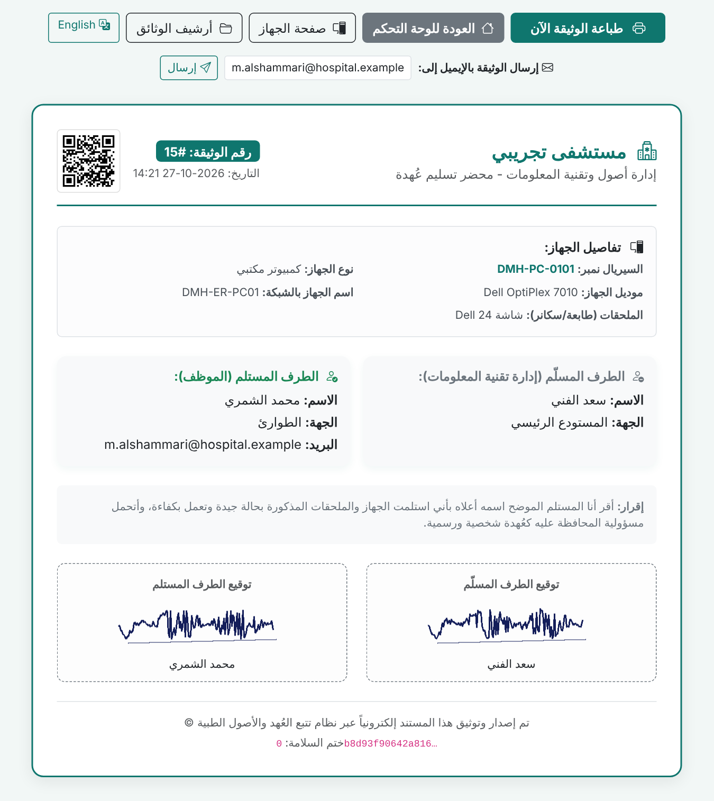

# نظام جرد الأصول وتتبع العهد

**كل جهاز معروف مكانه ومسؤوله، وكل حركة عليه موثّقة بتوقيع.**

[English](README.md)

## المشكلة

خلال تدريبي في القطاع الصحي، لاحظت مشكلة متكررة: أجهزة تقنية المعلومات موزعة على عشرات الأقسام، وعهدها موثقة في ملفات إكسل ونماذج ورقية متفرقة. من استلم الجهاز؟ ومتى؟ ولماذا انتقل؟ أسئلة يستغرق جوابها وقتاً وجهداً.

ومن خبرتي العملية في الإدارة والتعامل مع المبالغ والمصروفات والجرد، تعلمت قاعدة واحدة: **أي عهدة بدون توقيع وتاريخ ومسؤول واضح، هي مشكلة تنتظر وقتها.**

فجمعت بين هذه الخبرة وتخصصي في علوم الحاسب بجامعة حائل، وبنيت نظاماً متكاملاً من الصفر لحل هذا الاحتياج.

## ماذا يقدم النظام

| الميزة | الوصف |
|---|---|
| **محاضر عهدة موقّعة** | كل تسليم أو نقل أو إرجاع أو صيانة يُصدر وثيقة رسمية بتوقيع إلكتروني من الطرفين، وتُرسل لإيميل الموظف تلقائياً |
| **سجلات دائمة** | قاعدة البيانات ترفض الحذف، وكل وثيقة مختومة بختم مترابط يكشف أي تلاعب |
| **باركود لكل جهاز** | تصوير الباركود بالجوال يفتح صفحة الجهاز وتاريخه كاملاً |
| **الجرد الدوري** | مسح الأجهزة بالجوال أو قارئ الباركود، وتقرير بالموجود والمفقود والموجود في غير قسمه |
| **إخلاء الطرف** | إرجاع كل عهد الموظف بخطوة واحدة، وإصدار شهادة إخلاء طرف |
| **الصيانة والاستبدال** | توصية باستبدال الجهاز الذي يتعطل 3 مرات خلال 12 شهراً، وتنبيه قبل انتهاء الضمان |
| **الشراء والشبكة والأمان** | المورد والسعر والضمان، وعنوان الشبكة، ونظام التشغيل، وحالة مضاد الفيروسات |
| **التقارير** | رسوم بيانية قابلة للطباعة حسب الحالة والنوع والقسم والضمان |
| **الإكسل** | استيراد ملف الجرد الحالي وتوحيد أسماء الأقسام، وتصدير الأجهزة والسجل الكامل |
| **الصلاحيات واللغة** | صلاحيتان (مدير وفني)، ويدعم العربية والإنجليزية، ويعمل على الجوال |
| **النسخ الاحتياطي** | نسخة يومية تلقائية، وأرشيف شهري دائم |
| **يعمل بدون إنترنت** | كل المكتبات محفوظة داخل النظام، فيعمل بالكامل داخل شبكة مغلقة |

## صور من النظام

<table>
<tr>
<td width="50%"><b>محضر تسليم عهدة</b> </td>
<td width="50%"><b>صفحة الجهاز</b> </td>
</tr>
<tr>
<td><b>الجرد الدوري</b> </td>
<td><b>الصيانة وتوصيات الاستبدال</b> </td>
</tr>
</table>

> كل الصور من نسخة تجريبية بأسماء وبيانات وهمية. باقي الصور في [الصفحة الإنجليزية](README.md#screenshots).

## الأمان والاختبارات

قبل أن أقول إن النظام جاهز، وضعت نفسي مكان المهاجم وحاولت اختراقه، وكتبت أربع مجموعات من الاختبارات الآلية:

| مجموعة الاختبار | ماذا تفحص | النتيجة |
|---|---|---|
| اختبار الأمان الشامل | الدخول، والصلاحيات، والحقن، والملفات، والجلسات، وكل المميزات | **188 / 188** |
| مصفوفة الصلاحيات والهجمات | كل صفحة لكل نوع مستخدم (42 مساراً)، مع 630 طلباً هجومياً | **20 / 20** |
| الهجوم على سيرفر شغّال | هجمات حقيقية عبر الشبكة على النظام وهو يعمل | **36 / 36** |
| سيناريوهات المستخدمين | رحلة كاملة في المتصفح كفني وكمدير وعلى الجوال | **52 / 52** |
| **المجموع** | | **296 / 296** |

**الهجمات التي جُرّبت:** حقن قواعد البيانات، وحقن الأكواد، وتخمين كلمات المرور، وتجاوز الصلاحيات، وتزوير الطلبات، وسرقة الجلسات وتزويرها، وملفات إكسل خبيثة، والوصول لملفات حساسة، والتنفيذ المتزامن، وتزوير السجلات. ونجح النظام في صدّها كلها.

أثناء الاختبار اكتشفت **8 مشكلات حقيقية** (أمنية ووظيفية) وأصلحتها كلها. وللتأكد من دقة الاختبارات نفسها، زرعت ثغرة متعمدة في الكود، فكشفتها الاختبارات مباشرة.

## تصميم قاعدة البيانات

تسعة جداول، قلبها جدولان: **الأجهزة** (الحالة الحالية) و**الحركات والوثائق** (السجل الدائم المختوم، مع نسخة من بيانات الجهاز لحظة إصدار كل وثيقة).

## دوري في المشروع

بنيت المشروع بمفردي كاملاً: تحليل الاحتياج، وتصميم قاعدة البيانات، والخلفية، والواجهة، والحماية، والاختبارات الآلية، ودليل التركيب، وأدلة المستخدمين (الفني والمدير وتقنية المعلومات والتدريب، بالعربية والإنجليزية).

## الكود المصدري

الكود محفوظ في مستودع خاص، لأن النظام مخصص لبيئة صحية. **متاح عند الطلب** لمراجعته في المقابلات.

## عني

**عبدالله يوسف الصقعبي** · طالب علوم الحاسب، جامعة حائل

[LinkedIn](https://www.linkedin.com/in/abdullah-alsaqabi0)

---

© 2026 عبدالله يوسف الصقعبي. جميع الحقوق محفوظة.

