

# Hospital Asset Inventory & Custody Tracking System

**Every IT device has a known location and a responsible person, and every movement is documented with a signature.**

[العربية](README.ar.md) · [Screenshots](#screenshots) · [Security & Testing](#security--testing) · [Database Design](#database-design)

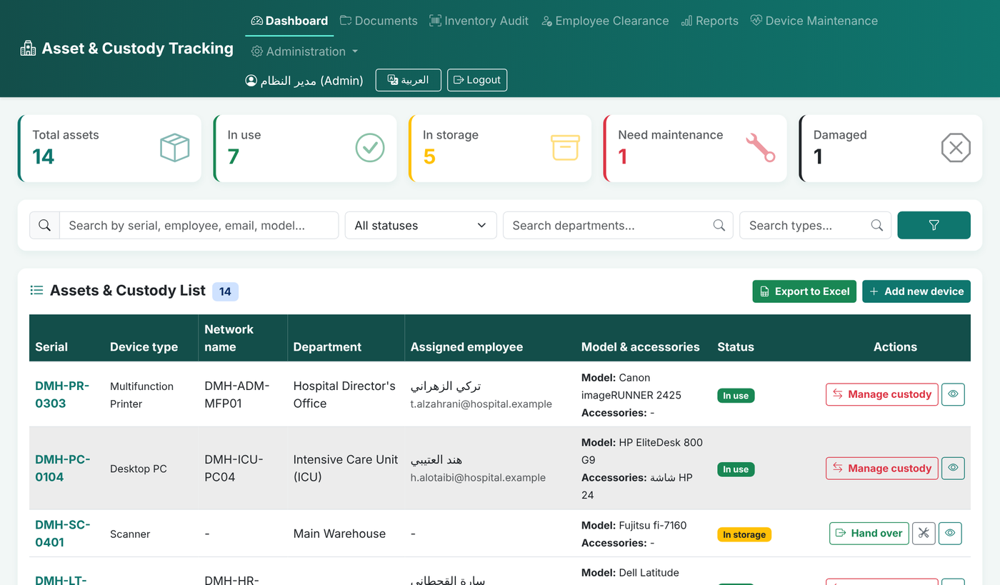

## The problem

During my training in the healthcare sector, I noticed a recurring problem: IT devices are spread across dozens of departments, and their custody is recorded in scattered Excel files and paper forms. Who has this device? Since when? Why was it moved? Answering these questions took real time and effort.

From my practical experience in administration, handling funds and expenses, and inventory, I learned one rule: **any custody item without a signature, a date and a clearly responsible person is a problem waiting to happen.**

So I combined that experience with my Computer Science studies at the University of Ha'il, and built a complete system from scratch to solve it.

## What the system does

| Feature | Description |
|---|---|
| **Signed custody records** | Every handover, transfer, return, maintenance or write-off issues an official document signed electronically by both parties, and emailed to the employee automatically |
| **Permanent records** | The database refuses deletion, and every document carries a chained integrity seal that reveals any tampering |
| **QR code per device** | Scan with a phone to open the device page and its full history |
| **Inventory audits** | Scan devices by phone or barcode reader; the system reports found, missing and misplaced devices |
| **Employee clearance** | Return all of an employee's items in one step and issue a clearance certificate |
| **Maintenance insights** | Devices that fail 3 times within 12 months are flagged for replacement; warranty expiry alerts |
| **Purchase, network & security data** | Supplier, price, warranty, IP / MAC, operating system and antivirus status per device |
| **Reports** | Printable charts by status, type, department, warranty, OS and antivirus status |
| **Excel import / export** | Imports the existing inventory spreadsheet and normalizes inconsistent department names |
| **Roles & languages** | Administrator and technician roles; full Arabic and English interface; works on phones |
| **Backups** | Automatic daily backups with a permanent monthly archive |
| **Runs offline** | All libraries are bundled, so it runs entirely inside a closed hospital network |

## Screenshots

<table>
<tr>
<td width="50%"><b>Handover with signatures from both parties</b> 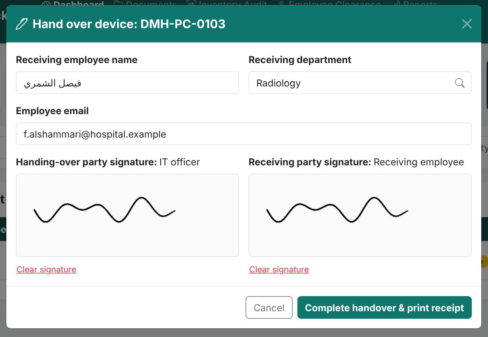</td>
<td width="50%"><b>The official handover record</b> 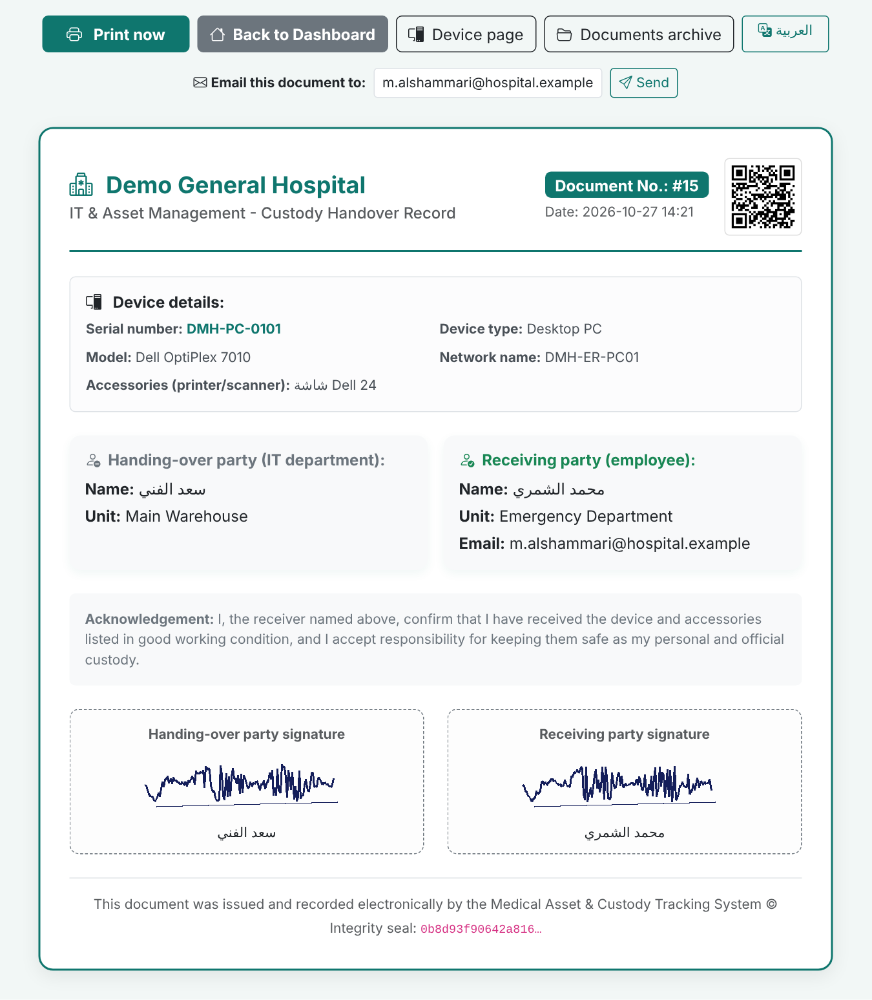</td>
</tr>
<tr>
<td><b>Device page: details, QR code, warranty and full history</b> 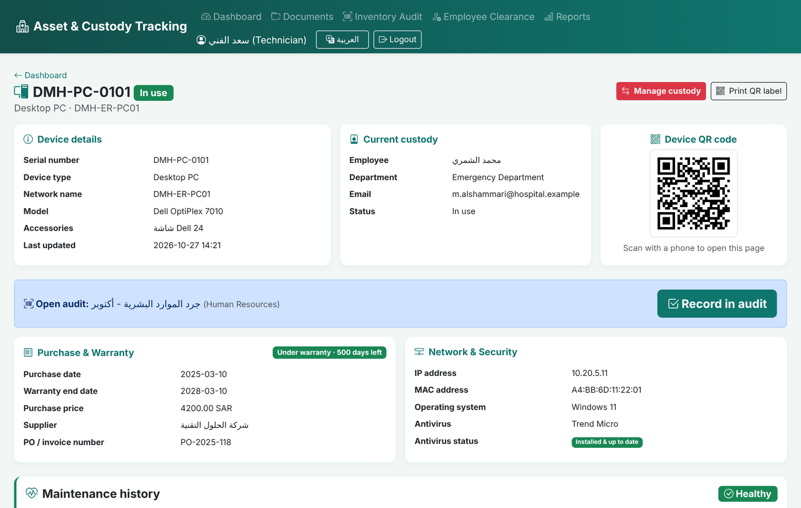</td>
<td><b>Employee clearance certificate</b> 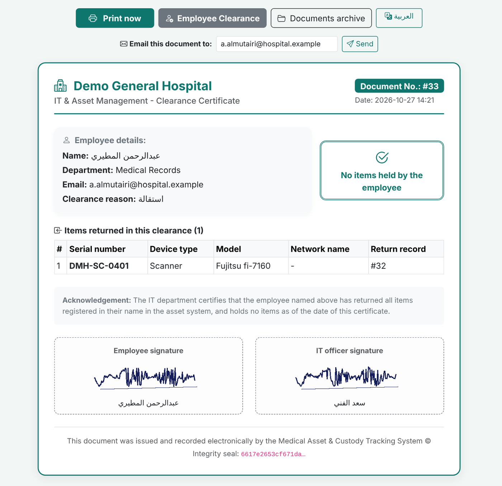</td>
</tr>
<tr>
<td><b>Inventory audit: found, missing and misplaced</b> 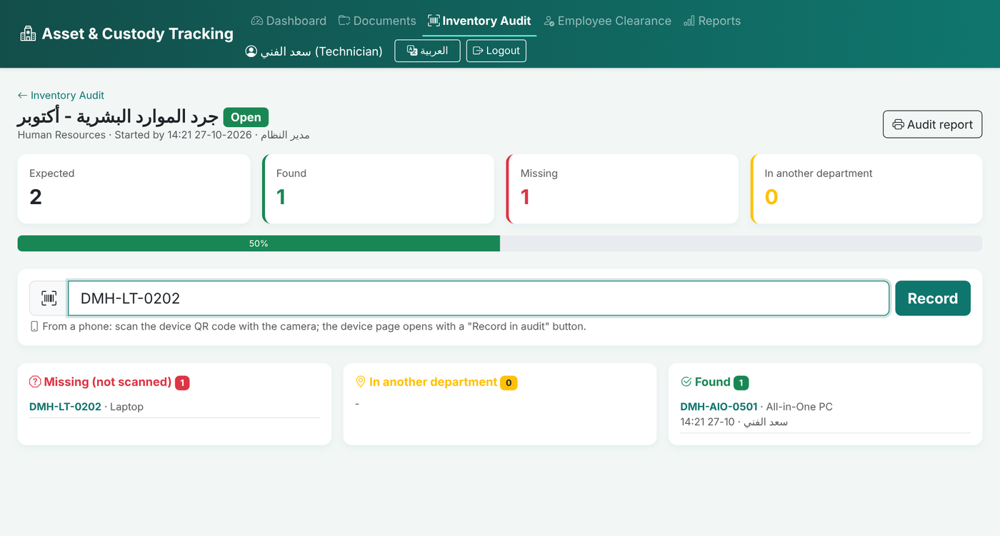</td>
<td><b>Maintenance and replacement recommendations</b> 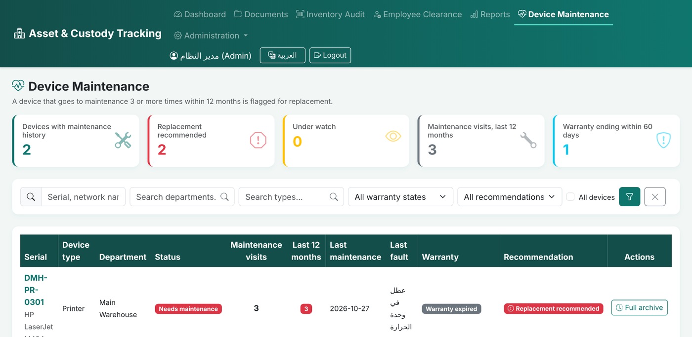</td>
</tr>
<tr>
<td><b>Reports and statistics</b> 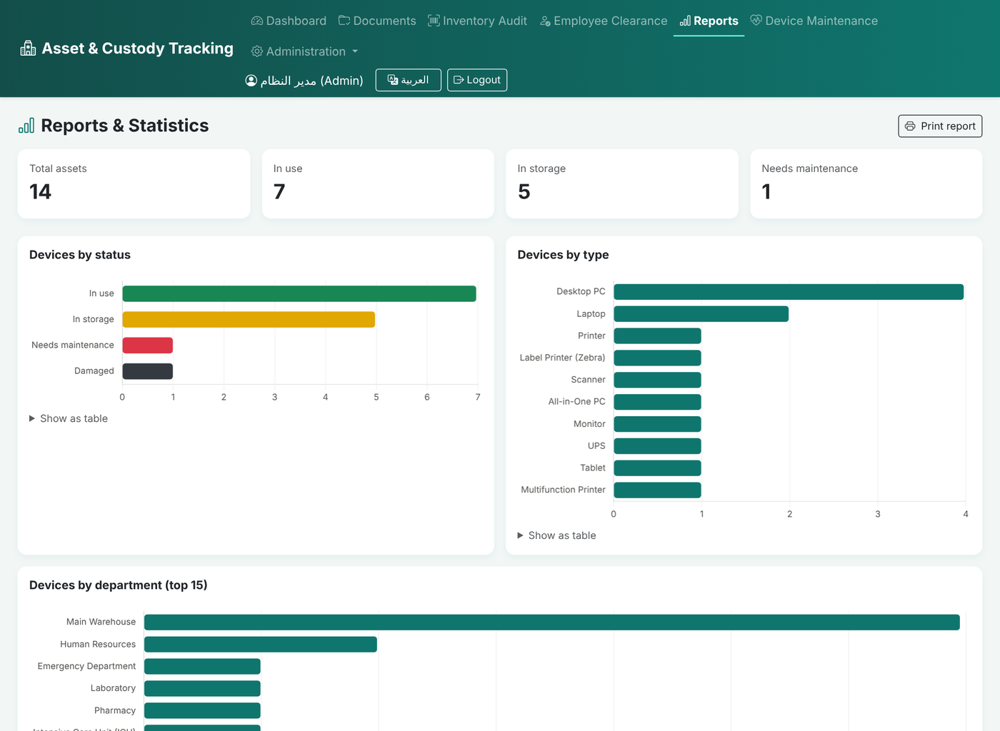</td>
<td><b>Transferring custody with a mandatory reason</b> 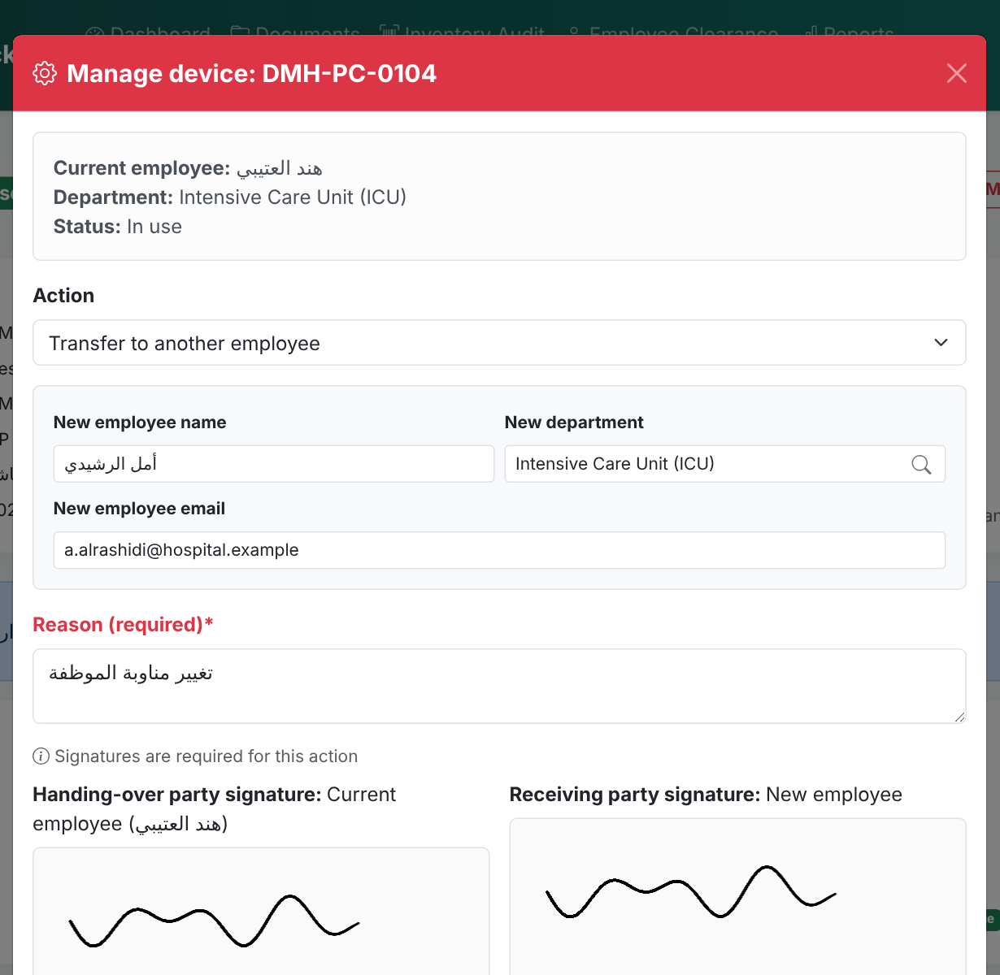</td>
</tr>
<tr>
<td><b>Full Arabic interface (right-to-left)</b> 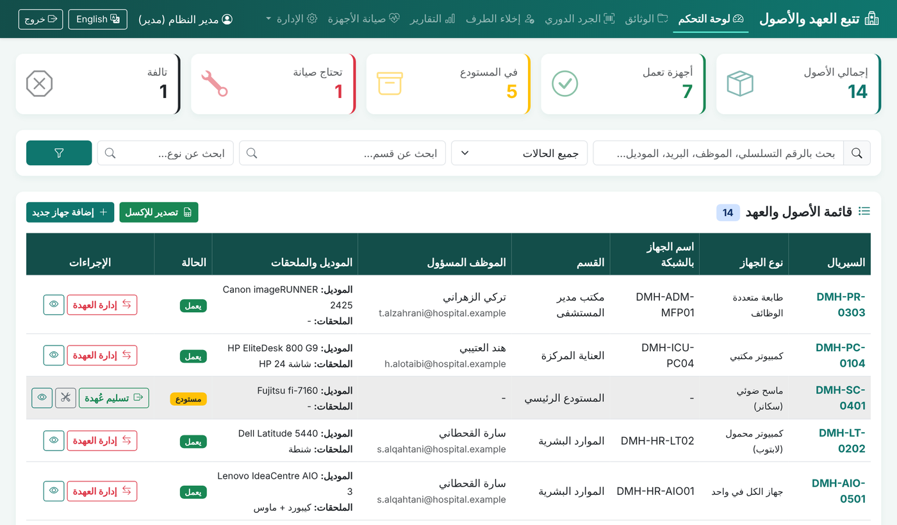</td>
<td align="center"><b>Recording an audit from a phone</b> 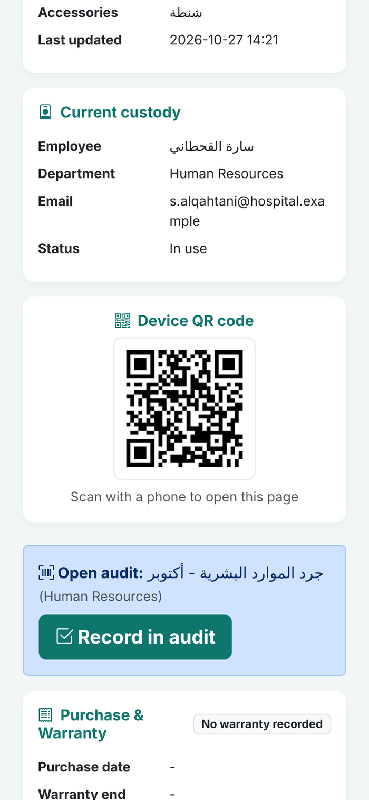</td>
</tr>
</table>

> All screenshots use a demo instance with fictional names and data.

## Security & Testing

Before calling the system ready, I put myself in the attacker's position and tried to break it. I wrote four automated test suites:

| Test suite | What it covers | Result |
|---|---|---|
| Full security test | Sign-in, permissions, injection, files, sessions and every feature | **188 / 188** |
| Permission & attack matrix | Every page for every user type (42 routes), with 630 malicious requests | **20 / 20** |
| Live server attack | Real network attacks against the running server | **36 / 36** |
| User journeys (Playwright) | Full browser journeys as a technician, an administrator and on a phone | **52 / 52** |
| **Total** | | **296 / 296** |

**Attacks tried against the system**

| Attack | Result |
|---|---|
| SQL injection in every form and search box | Blocked, data intact |
| Stored cross-site scripting (XSS) and template injection | Rendered as plain text, never executed |
| Password brute force | Sign-in locked for 10 minutes after 5 failures, per account and per IP address |
| Privilege escalation (technician → administrator) | Blocked on every page and action |
| Cross-site request forgery (CSRF) | Rejected on every form |
| Session hijacking and session forging | Sessions are revoked server-side on sign-out; forged cookies rejected |
| Malicious Excel files (zip bombs, formula injection) | File rejected; exported formulas neutralized |
| Path traversal and access to sensitive files | Not accessible |
| Race condition: two technicians handing over the same device at the same moment | Only one action is accepted |
| Log forging and hidden text-direction characters | Escaped and stripped |

While testing, I found **8 real issues** (security and functional) and fixed all of them before release. To make sure the tests themselves are reliable, I planted a deliberate weakness in the code, and the tests caught it immediately.

Additional hardening: hashed passwords with strength rules, strict Content Security Policy with nonces, Subresource Integrity on every library, HttpOnly and SameSite session cookies, and security headers on every response.

## Database Design

Nine tables. At the core are two: **devices** (current state) and **events & documents** (the permanent, sealed history, each keeping a snapshot of the device at the moment of issue).

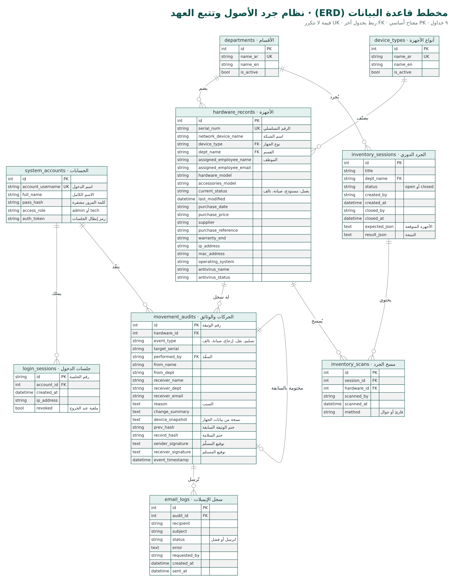

## Tech stack

| Layer | Technology |
|---|---|
| Backend | Python, Flask, Flask-Login, SQLAlchemy |
| Database | SQLite (WAL mode) with triggers that block deletion |
| Frontend | HTML, CSS, JavaScript, Jinja2, Bootstrap, Chart.js |
| Server | Waitress, Cheroot (HTTPS) |
| Testing | Python test client, Requests, Playwright |

## My role

I built this project on my own, end to end: requirements, database design, backend, frontend, security hardening, automated testing, deployment guide, and user documentation (technician, administrator, IT and training guides in Arabic and English).

## Source code

The source code is kept in a private repository, because the system is intended for a healthcare environment. **It is available on request** for review during interviews.

## About me

**Abdullah Yousef Alsaqabi** · Computer Science student, University of Ha'il

[LinkedIn](https://www.linkedin.com/in/abdullah-alsaqabi0)

---

© 2026 Abdullah Yousef Alsaqabi. All rights reserved.
